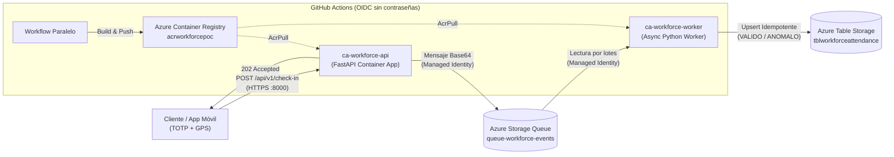

# Azure Serverless Workforce POC — Sistema Event-Driven de Control Horario

Prueba de concepto (PoC) de una arquitectura orientada a eventos (*event-driven*), desacoplada y **100% Zero-Secrets** sobre Microsoft Azure para la ingestión, validación y auditoría de fichajes laborales.

---

## 1. Propósito del Proyecto (Qué se quiere lograr)

En escenarios reales de gestión de personal (*Workforce Management*), los sistemas tradicionales de fichaje sufren dos problemas críticos: **cuellos de botella en horas punta** (cientos de empleados fichando simultáneamente) y **falta de trazabilidad antifraude** (suplantación de identidad o fichajes fuera del centro de trabajo).

Este proyecto resuelve ambos retos mediante tres objetivos técnicos y de negocio:

1. **Ingestión asíncrona de alta disponibilidad:** Desacoplar la recepción del fichaje de su procesamiento. La API valida el formato y la autenticidad del empleado en milisegundos, encola el evento y responde `202 Accepted` sin bloquear al cliente por operaciones de base de datos.
2. **Auditoría automática de reglas laborales y geolocalización:** Evaluar de forma asíncrona cada evento contra el cuadrante asignado al empleado, detectando automáticamente retrasos, salidas anticipadas o fichajes fuera del perímetro GPS autorizado (Fórmula de *Haversine*), clasificándolos como `VALIDO` o `ANOMALO`.
3. **Arquitectura Cloud-Native sin credenciales almacenadas (*Zero-Secrets*):** Eliminar por completo el uso de cadenas de conexión, contraseñas o *SAS tokens* tanto en el código fuente como en el pipeline de CI/CD, operando exclusivamente mediante **User-Assigned Managed Identities**, **RBAC de mínimo privilegio** y **OIDC**.

---

## 2. Arquitectura y Flujo de Datos



### Stack Tecnológico e Infraestructura (`rg-workforce-app`)

| Componente | Recurso en Azure | Tecnología / Rol |
| :--- | :--- | :--- |
| **Infraestructura como Código** | `infrastructure/*.tf` | Terraform (`azurerm`) declarativo y modular |
| **Entorno de Ejecución** | `cae-workforce-app` | Azure Container Apps Environment (Modo *Express*) |
| **Registro de Contenedores** | `acrworkforcepoc` | Azure Container Registry (imágenes Docker *slim* no-root) |
| **API de Ingestión** | `ca-workforce-api` | Python 3.11, FastAPI, Pydantic v2, PyOTP (puerto `8000`) |
| **Cola de Mensajería** | `queue-workforce-events` | Azure Storage Queue en `stworkforcepoc` |
| **Consumidor Asíncrono** | `ca-workforce-worker` | Worker Python `asyncio` + motor de reglas de negocio |
| **Persistencia NoSQL** | `tblworkforceattendance` | Azure Table Storage (`PartitionKey=employee_id`) |
| **Identidades y Seguridad** | `id-ca-workforce-api`<br/>`id-workforce-worker`<br/>`id-github-actions` | Managed Identities + RBAC (`Storage Queue Data Contributor`, `Storage Queue Data Message Processor`, `Storage Table Data Contributor`, `AcrPull`) |

---

## 3. Estado Actual (Lo que ya está realizado)

* **Fase 1 — Infraestructura Base e Identidades (Terraform):** Aprovisionamiento del grupo de recursos, entorno de Container Apps, ACR, cuenta de almacenamiento `stworkforcepoc`, cola de eventos y asignación de roles RBAC granulares.
* **Fase 2 — Microservicio de Ingestión (`src/api_ingestion/`):**
  * Endpoint `POST /api/v1/check-in` con validación estricta de esquema y verificación de código temporal **TOTP** (`pyotp`).
  * Publicación asíncrona en Base64 sobre `queue-workforce-events` mediante `DefaultAzureCredential`.
  * Contenedor endurecido ejecutándose bajo usuario sin privilegios (`appuser`) en el puerto `8000`.
* **Fase 3 — Base de Datos NoSQL y Consumidor (`src/async_worker/`):**
  * Creación de `tblworkforceattendance` con diseño idempotente (`PartitionKey = employee_id`, `RowKey = {timestamp}_{message_id}`) para tolerar entregas duplicadas (*at-least-once delivery*).
  * Motor de validación (`business_rules.py`) con cálculo de distancia GPS mediante **Haversine** (radio máximo de 250 m) y cruce horario contra cuadrante simulado (`RETRASO_ENTRADA`, `SALIDA_ANTICIPADA`, `UBICACION_FUERA_DE_RANGO`, `SIN_TURNO_ASIGNADO`).
  * Garantía transaccional: el mensaje solo se elimina de la cola tras confirmar su escritura en Table Storage.
* **Fase 4 — Pipeline CI/CD Paralelo (`.github/workflows/deploy-api.yml`):**
  * Autenticación federada con Azure mediante **OIDC**.
  * Ejecución en paralelo de dos *jobs* independientes (`deploy-api` y `deploy-worker`) que compilan las imágenes etiquetadas con `github.sha`, las publican en ACR y actualizan ambas Container Apps usando el `clientId` de sus respectivas Managed Identities.

---

## 4. Hoja de Ruta (Qué se va a realizar exactamente)

Para evolucionar esta PoC hacia una solución lista para integración con sistemas de RR. HH. y nóminas (ERP/SAP), los próximos pasos planificados son:

1. **Endpoint de Consulta y Auditoría (`GET /api/v1/attendance/{employee_id}`):**
   * Exponer rutas de lectura en `ca-workforce-api` (con rol `Storage Table Data Reader`) para consultar el historial de fichajes de un empleado por rango de fechas y filtrar incidencias (`ValidationStatus eq 'ANOMALO'`) para su revisión por Recursos Humanos.
2. **Catálogo Dinámico de Cuadrantes y Sedes:**
   * Migrar el diccionario estático `MOCK_ROSTER` de `business_rules.py` a una tabla maestra en Azure Table Storage (`tblworkforceroster`), permitiendo actualizar turnos, tolerancias y coordenadas de centros de trabajo sin redesplegar código.
3. **Pruebas Automáticas (*Smoke Tests*) y Observabilidad en CI/CD:**
   * Incorporar un paso de verificación HTTP post-despliegue en GitHub Actions.
   * Configurar consultas KQL y alertas en **Azure Log Analytics** (`law-workforce-app`) para monitorizar mensajes envenenados (*poison messages* con `dequeue_count > 3`) y anomalías recurrentes.
4. **Escalado Elástico a Cero con KEDA (Entorno *Workload Profiles*):**
   * Migrar `cae-workforce-app` de entorno *Express* a *Consumption Workload Profiles* para habilitar reglas nativas `azure-queue` de KEDA, permitiendo que `ca-workforce-worker` escale automáticamente de `0` réplicas en reposo hasta `N` réplicas bajo picos de fichajes.

---

## 5. Estructura del Repositorio

```text
azure-serverless-workforce-poc/
├── .github/
│   └── workflows/
│       └── deploy-api.yml          # CI/CD paralelo con OIDC (API + Worker)
├── infrastructure/
│   ├── main.tf                     # RG, ACR, Container Apps Env y API
│   ├── storage_queue.tf            # Storage Account, Queue y RBAC de ingestión
│   ├── storage_table.tf            # Table Storage, identidad Worker y RBAC
│   ├── worker.tf                   # Container App ca-workforce-worker
│   └── outputs.tf                  # Salidas de infraestructura
├── src/
│   ├── api_ingestion/
│   │   ├── main.py                 # FastAPI + TOTP + Queue Producer
│   │   ├── schemas.py              # Modelos Pydantic v2
│   │   ├── test.py                 # Cliente de pruebas end-to-end
│   │   ├── requirements.txt
│   │   └── Dockerfile
│   └── async_worker/
│       ├── worker.py               # Consumidor asíncrono de cola -> Table
│       ├── business_rules.py       # Motor de cuadrantes y geofencing Haversine
│       ├── requirements.txt
│       └── Dockerfile
└── README.md
```

---

## 6. Validación y Operación Rápida

### Ejecutar prueba completa en la nube (End-to-End)

```bash
# 1. Activar entorno virtual local
source venv/bin/activate

# 2. Enviar fichaje TOTP a la API desplegada en Azure
python src/api_ingestion/test.py

# 3. Consultar registros procesados por el Worker en Azure Table Storage
az storage entity query \
  --account-name stworkforcepoc \
  --table-name tblworkforceattendance \
  --auth-mode login \
  --query "items[].{Empleado:PartitionKey, Tipo:EventType, Estado:ValidationStatus, Motivo:AnomalyReason, Procesado:ProcessedAt}" \
  -o table
```

### Control de consumo (Apagado y encendido manual)

Para evitar consumir cuota gratuita mensual cuando el entorno no esté en uso:

```bash
# Detener contenedores (0 réplicas)
az containerapp update --name ca-workforce-api --resource-group rg-workforce-app --min-replicas 0 --max-replicas 0
az containerapp update --name ca-workforce-worker --resource-group rg-workforce-app --min-replicas 0 --max-replicas 0

# Reactivar contenedores (1 réplica)
az containerapp update --name ca-workforce-api --resource-group rg-workforce-app --min-replicas 1 --max-replicas 3
az containerapp update --name ca-workforce-worker --resource-group rg-workforce-app --min-replicas 1 --max-replicas 1
```